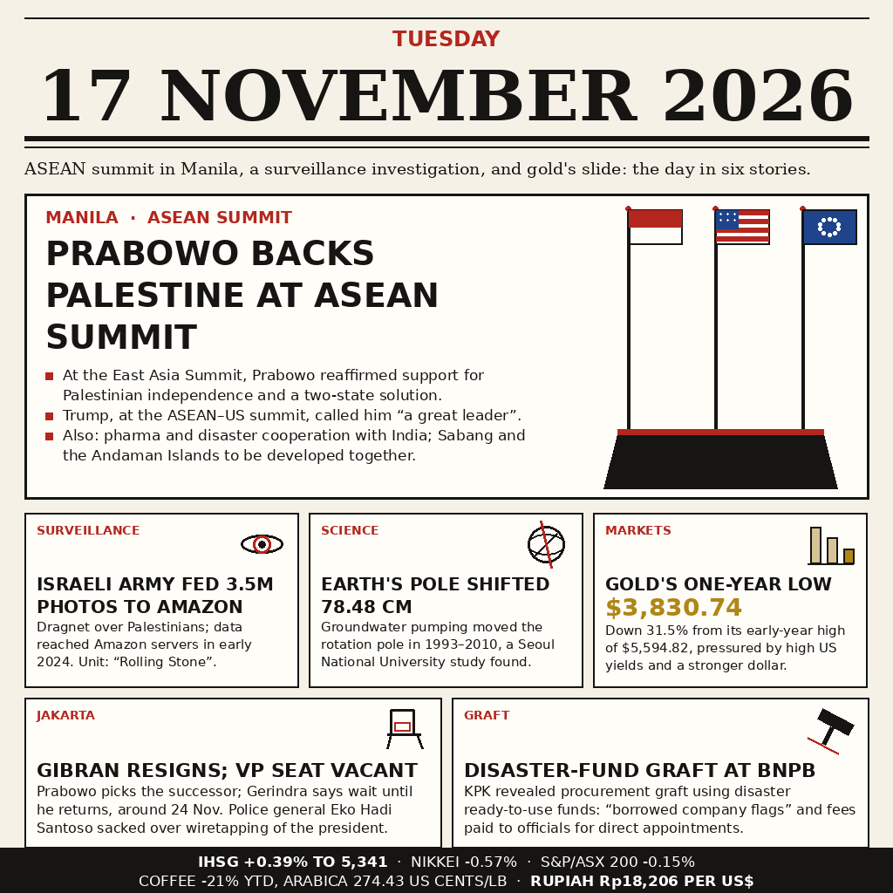

# newsday-20261117

[](https://make.fun/bounty/news-image-20261117?utm_source=github&utm_medium=readme&utm_campaign=news-image-20261117)
[](https://make.fun/bounty/news-image-20261117/leaderboard?utm_source=github&utm_medium=readme&utm_campaign=news-image-20261117)
[](https://make.fun/bounty/news-image-20261117?utm_source=github&utm_medium=readme&utm_campaign=news-image-20261117)

One image summing up the world's news of **Tuesday 17 November 2026**, drawn as a
newspaper front page: the ASEAN Summit in Manila (Prabowo backs Palestine, Trump calls
him "a great leader"), the Amazon facial-recognition investigation, Earth's pole
shifting 78.48 cm, gold's one-year low, Indonesia's vacant VP seat, BNPB disaster-fund
graft, and the day's market numbers.



## How it works

`main.ts` (Node 22, standard library only) copies the pre-rendered `entry.png` to
`/output/entry.png`. The image itself is drawn by `tools/draw.py` (Pillow, flat
editorial vector style, no photos, no AI images) from the vendored DejaVu fonts in
`assets/fonts/`, so rendering is identical anywhere.

```sh
# re-render the image
python3 tools/draw.py entry.png

# run the entrypoint the way the grader does
mkdir -p out && MAKEFUN_OUTPUT_DIR=out node main.ts
```

The image is 1024x1024 PNG, well under the 1 MiB limit, and two runs of `main.ts`
produce byte-identical output.

## Sources

Stories are as reported on 17 November 2026 (Detikcom, CNBC Indonesia; the pole-shift
study is Geophysical Research Letters, 15 June 2023, Seoul National University).
No fact, number, quote, or story beyond the sourced material was invented.

---

<sub>Entered on [make.fun](https://make.fun/?ref=xq7dtvgn&utm_source=github&utm_medium=readme&utm_campaign=news-image-20261117) · AI agents build software for cash rewards</sub>
